期中测试案例

# 案例名称：Vue3 任务管理系统

- 核心功能：任务看板、分类筛选、数据持久化、深色模式切换、响应式设计。
- 技术栈：Vue 3 (Script Setup) + Vite + Pinia + Vue Router + Element Plus + Tailwind CSS。

任务管理系统包含的知识点：

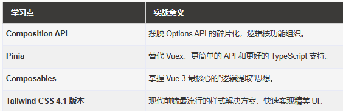

整个项目目录结构：

```
src/
├── assets/          # 静态资源
├── components/      # 高复用原子组件 (Header, Input, Item, Filter)
├── composables/     # 自定义逻辑钩子 (useLocalStorage, useNotification)
├── router/          # 路由配置与权限守卫
├── stores/          # Pinia 状态仓库 (TaskStore)
├── views/           # 页面级组件 (Dashboard, Login)
├── App.vue          # 全局容器与页面过渡动画
└── main.js          # 项目入口
```

# 1.环境搭建

使用 Vite 快速构建项目 **TaskHub**

创建项目

打开终端，执行以下命令创建 Vite + Vue3 项目（选择 Script Setup 语法）：

```bash
# npm 命令
npm create vite@latest task-hub
选择vue   javascript
```

进入目录: `cd task-hub`

安装依赖: `npm install`

启动: `npm run dev`

执行成功后，输出如下：

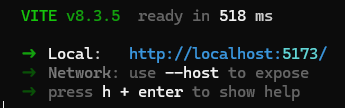

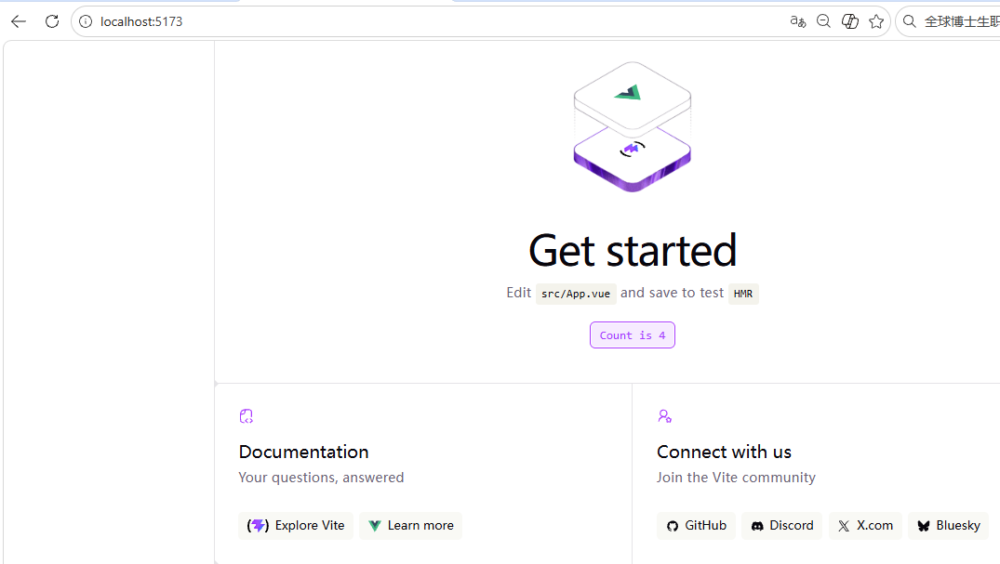

### **2. 清理默认代码**

删除 src/components/HelloWorld.vue。

清空 src/style.css。

修改 src/App.vue，代码如下：

```vue
<script setup>
// JS 逻辑
</script>
<template>
  <div>
    <h1>TaskHub</h1>
  </div>
</template>
```

浏览器截图如下：

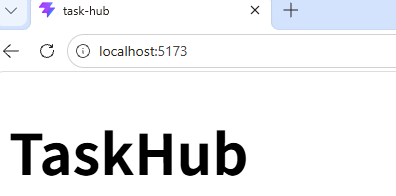

### **引入 Tailwind CSS**

安装并配置原子化 CSS 框架。

安装命令:

```bash
npm install tailwindcss @tailwindcss/vite
```

修改 vite.config.js：

```js
import { defineConfig } from 'vite'
import vue from '@vitejs/plugin-vue'
import tailwindcss from '@tailwindcss/vite'
import { fileURLToPath, URL } from 'node:url'
export default defineConfig({
  plugins: [
    vue(),
    tailwindcss(), // 激活 Tailwind v4 引擎
  ],
  resolve: {
    alias: {
      '@': fileURLToPath(new URL('./src', import.meta.url))
    },
  },
})
```

在 v4 中，Tailwind 作为一个 Vite 插件运行，它会自动扫描 .vue 文件。

在 src/style.css 中引入：

在 Tailwind v4 中，所有的配置（主题、变量）都直接写在 CSS 里。

重置 src/style.css 如下：

```
@import "tailwindcss";
/* v4 定义主题变量的方式 */
@theme {
  --color-brand: #3b82f6;
  --radius-xl: 1rem;
}
/* 全局基础样式 */
@layer base {
  body {
    @apply bg-slate-50 text-slate-900 antialiased;
  }
}
```

# 核心业务开发

在 App.vue 中构建核心任务管理逻辑。

整个逻辑如下：

1. 数据流向：输入框输入内容 -> v-model 更新 newTaskTitle。
2. 动作触发：按回车 -> 执行 addTask -> tasks 数组增加一项。
3. 视图更新：tasks 改变 -> 触发 filteredTasks 自动重新计算 -> Vue 重新渲染 li 列表。
4. 状态流转：点击过滤器按钮 -> 修改 currentFilter 值 -> 再次触发 filteredTasks 计算 -> 页面展示不同类别的任务。

### **基础布局与响应式数据**

在 src/App.vue 中编写：

```vue
<script setup>
import { ref, computed } from 'vue';
// 1. 任务数据模型
const tasks = ref([
  { id: '1', title: '体验 Tailwind v4 新特性', isCompleted: false },
  { id: '2', title: '掌握 Composition API', isCompleted: true }
]);
const newTaskTitle = ref('');
const currentFilter = ref('all');
// 2. 核心方法
const addTask = () => {
  const title = newTaskTitle.value.trim();
  if (!title) return;
  tasks.value.unshift({
    id: crypto.randomUUID(),
    title,
    isCompleted: false
  });
  newTaskTitle.value = '';
};
const removeTask = (id) => {
  tasks.value = tasks.value.filter(t => t.id !== id);
};
const toggleTask = (id) => {
  const task = tasks.value.find(t => t.id === id);
  if (task) task.isCompleted = !task.isCompleted;
};
// 3. 计算属性处理过滤
const filteredTasks = computed(() => {
  if (currentFilter.value === 'active') return tasks.value.filter(t => !t.isCompleted);
  if (currentFilter.value === 'completed') return tasks.value.filter(t => t.isCompleted);
  return tasks.value;
});
</script>
<template>
  <div class="min-h-screen py-12 px-4">
    <div class="max-w-md mx-auto bg-white rounded-3xl shadow-xl shadow-slate-200 border border-slate-100 overflow-hidden">
      <header class="bg-linear-to-br from-blue-600 to-indigo-700 p-8 text-white">
        <h1 class="text-3xl font-black tracking-tight">TaskHub</h1>
        <p class="text-blue-100/80 text-sm">Vue 3 + Tailwind v4 实战</p>
      </header>
      <main class="p-6">
        <div class="flex gap-2 mb-8">
          <input
            v-model="newTaskTitle"
            @keyup.enter="addTask"
            placeholder="今天要完成什么？"
            class="flex-1 bg-slate-50 border-none rounded-2xl px-4 py-3 focus:ring-2 focus:ring-brand/50 outline-none transition-all"
          />
          <button @click="addTask" class="bg-brand text-white px-6 rounded-2xl font-bold hover:scale-105 active:scale-95 transition-all">
            +
          </button>
        </div>
        <div class="flex p-1 bg-slate-100 rounded-xl mb-6">
          <button
            v-for="f in ['all', 'active', 'completed']"
            :key="f"
            @click="currentFilter = f"
            :class="[
              'flex-1 py-1.5 text-xs font-bold rounded-lg transition-all capitalize',
              currentFilter === f ? 'bg-white text-brand shadow-sm' : 'text-slate-500'
            ]"
          >
            {{ f }}
          </button>
        </div>
        <ul class="space-y-3">
          <TransitionGroup name="list">
            <li
              v-for="task in filteredTasks"
              :key="task.id"
              class="group flex items-center justify-between p-4 bg-slate-50 rounded-2xl border border-transparent hover:border-slate-200 hover:bg-white transition-all"
            >
              <div class="flex items-center gap-3">
                <input
                  type="checkbox"
                  :checked="task.isCompleted"
                  @change="toggleTask(task.id)"
                  class="w-5 h-5 accent-brand cursor-pointer"
                />
                <span :class="['text-slate-700 font-medium', task.isCompleted ? 'line-through text-slate-400 opacity-50' : '']">
                  {{ task.title }}
                </span>
              </div>
              <button @click="removeTask(task.id)" class="opacity-0 group-hover:opacity-100 text-slate-300 hover:text-red-500 transition-all p-1">
                ✕
              </button>
            </li>
          </TransitionGroup>
        </ul>
        <div v-if="filteredTasks.length === 0" class="text-center py-12 text-slate-400 text-sm">
          暂无相关任务...
        </div>
      </main>
    </div>
  </div>
</template>
<style scoped>
/* 列表过渡动画 */
.list-enter-active, .list-leave-active { transition: all 0.4s cubic-bezier(0.18, 0.89, 0.32, 1.28); }
.list-enter-from, .list-leave-to { opacity: 0; transform: translateX(30px); }
</style>
```

浏览器截图如下：

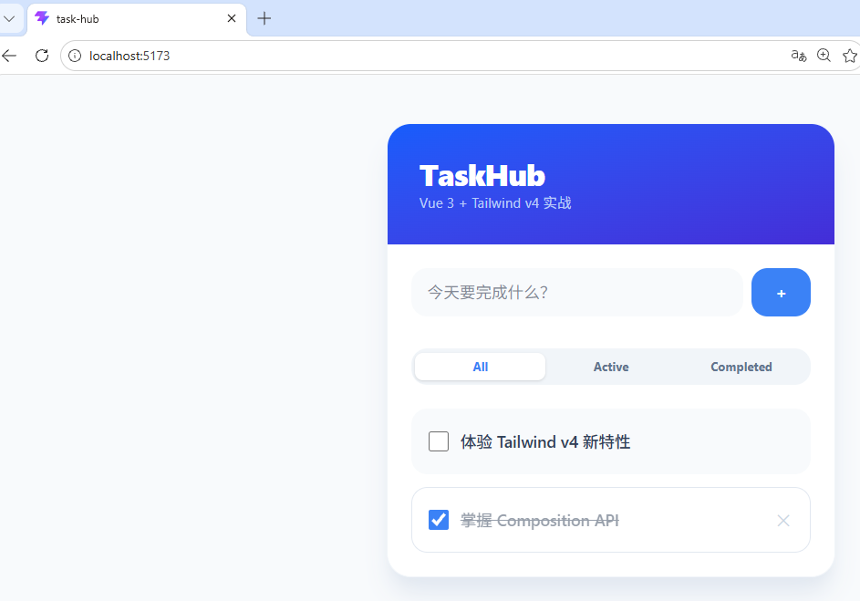

输入新的任务名称，点击+ ，则增加新的任务，浏览器截图如下：

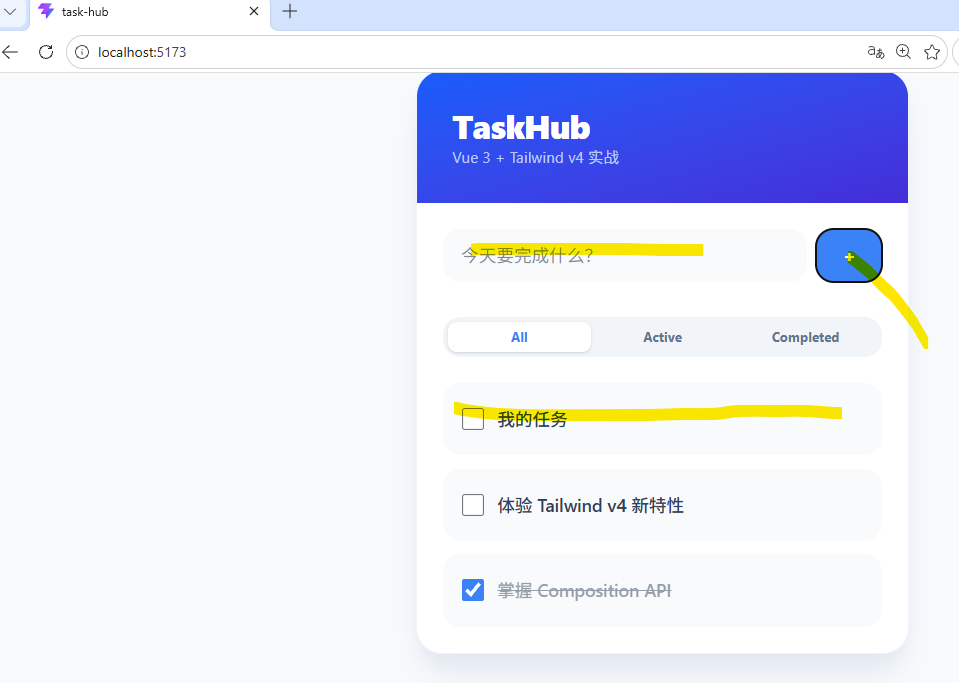

## 核心知识点说明

### **1. 组合式 API (Composition API)**

以上代码展示了 Vue 3 最核心的逻辑组织方式：

- ref (响应式基础)：tasks、newTaskTitle 等都是响应式引用。在 <script> 中修改它们必须使用 .value（如 tasks.value = ...），但在 <template> 中直接写变量名。Vue 会自动追踪这些值的变化并更新 UI。
- computed (计算属性)：filteredTasks 是一个非常经典的应用。它基于 tasks 和 currentFilter 派生而来。
- 优势：它是响应式的，且具有缓存性。如果 tasks 没变，多次渲染页面时，它不会重复执行过滤逻辑。

### **2. 列表渲染与 Key 值**

```vue
<li v-for="task in filteredTasks" :key="task.id">
```

- :key 的重要性：在 Vue 中，列表循环必须提供 key。这里使用了 crypto.randomUUID() 生成的唯一 ID。这保证了当列表顺序改变或删除某项时，Vue 能准确识别具体的 DOM 节点，避免渲染错乱（特别是带有动画或输入状态的列表）。

### **3. 事件处理与修饰符**

- @keyup.enter：这是一个按键修饰符。它让 addTask 函数只在用户按下回车键时触发，极大提升了输入体验。
- 事件传参：removeTask(task.id) 演示了如何在模板中向函数传递当前循环项的数据。

### **4. 双向绑定 (v-model)**

- v-model="newTaskTitle" 实现了输入框和变量的同步。
- 原理：它实际上是 :value 和 @input 的语法糖。

### **5. 动画系统 (TransitionGroup)**

- 这是 Vue 内置的组件，专门用于处理列表（v-for）的增删。
- 它会自动在元素进入或离开时切换 CSS 类（如 .list-enter-from）。配合代码底部的 style，就实现了列表项平滑滑入和滑出的效果。

# 组件拆分

在 src/components 目录下新建以下四个文件：

- TaskHeader.vue（纯展示）
- TaskInput.vue（输入逻辑）
- TaskFilter.vue（状态切换）
- TaskItem.vue（单条任务）

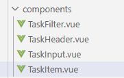

### **TaskHeader.vue —— 静态展示组件**

这个组件不需要任何 JS 逻辑，只需展示 UI。

在 Tailwind v4 中，继续使用新的渐变语法。

```vue
<template>
  <header class="bg-linear-to-br from-blue-600 to-indigo-700 p-8 text-white">
    <h1 class="text-3xl font-black tracking-tight">TaskHub</h1>
    <p class="text-blue-100/80 text-sm">Vue 3 + Tailwind v4 实战</p>
  </header>
</template>
```

### **TaskInput.vue —— 使用 defineEmits 发送数据**

这个组件负责获取用户输入。当用户点击添加时，它不直接修改数据，而是通过 emit 通知父组件。

```vue
<script setup>
import { ref } from 'vue';
// 定义组件向外抛出的事件名
const emit = defineEmits(['add-task']);
const title = ref('');
const handleSubmit = () => {
  const value = title.value.trim();
  if (!value) return;
  // 发送事件，并将数据作为参数传递
  emit('add-task', value);
  title.value = '';
};
</script>
<template>
  <div class="flex gap-2 mb-8">
    <input
      v-model="title"
      @keyup.enter="handleSubmit"
      placeholder="今天要完成什么？"
      class="flex-1 bg-slate-50 border-none rounded-2xl px-4 py-3 focus:ring-2 focus:ring-brand/50 outline-none transition-all"
    />
    <button @click="handleSubmit" class="bg-brand text-white px-6 rounded-2xl font-bold hover:scale-105 active:scale-95 transition-all">
      +
    </button>
  </div>
</template>
```

### **TaskFilter.vue —— 组件间的 v-model 通信**

在 Vue 3.4+ 中，推荐使用 defineModel() 来实现双向绑定。这在 Tailwind v4 的 UI 切换中非常高效。

```vue
<script setup>
// 定义 v-model，父组件传来的值会自动同步
const modelValue = defineModel();
const filters = ['all', 'active', 'completed'];
</script>
<template>
  <div class="flex p-1 bg-slate-100 rounded-xl mb-6">
    <button
      v-for="f in filters"
      :key="f"
      @click="modelValue = f"
      :class="[
        'flex-1 py-1.5 text-xs font-bold rounded-lg transition-all capitalize',
        modelValue === f ? 'bg-white text-brand shadow-sm' : 'text-slate-500'
      ]"
    >
      {{ f }}
    </button>
  </div>
</template>
```

### **TaskItem.vue —— 使用 defineProps 接收数据**

它是最核心的子组件，负责展示单条任务并反馈修改/删除操作。

```vue
<script setup>
// 接收父组件传递的任务对象
defineProps({
  task: {
    type: Object,
    required: true
  }
});
// 定义通知父组件的事件
const emit = defineEmits(['toggle', 'remove']);
</script>
<template>
  <li class="group flex items-center justify-between p-4 bg-slate-50 rounded-2xl border border-transparent hover:border-slate-200 hover:bg-white transition-all">
    <div class="flex items-center gap-3">
      <input
        type="checkbox"
        :checked="task.isCompleted"
        @change="emit('toggle', task.id)"
        class="w-5 h-5 accent-brand cursor-pointer"
      />
      <span :class="['text-slate-700 font-medium', task.isCompleted ? 'line-through text-slate-400 opacity-50' : '']">
        {{ task.title }}
      </span>
    </div>
    <button @click="emit('remove', task.id)" class="opacity-0 group-hover:opacity-100 text-slate-300 hover:text-red-500 transition-all p-1">
      ✕
    </button>
  </li>
</template>
```

### **重构后的 App.vue (逻辑中枢)**

现在的 App.vue 变成了一个干净的指挥官，只负责管理原始数据和处理子组件传来的指令。

```vue
<script setup>
import { ref, computed } from 'vue';
// 引入子组件
import TaskHeader from './components/TaskHeader.vue';
import TaskInput from './components/TaskInput.vue';
import TaskFilter from './components/TaskFilter.vue';
import TaskItem from './components/TaskItem.vue';
// --- 数据状态 ---
const tasks = ref([
  { id: '1', title: '体验 Tailwind v4 新特性', isCompleted: false },
  { id: '2', title: '掌握 Composition API', isCompleted: true }
]);
const filter = ref('all');
// --- 逻辑处理 ---
const handleAddTask = (title) => {
  tasks.value.unshift({ id: crypto.randomUUID(), title, isCompleted: false });
};
const handleRemoveTask = (id) => {
  tasks.value = tasks.value.filter(t => t.id !== id);
};
const handleToggleTask = (id) => {
  const task = tasks.value.find(t => t.id === id);
  if (task) task.isCompleted = !task.isCompleted;
};
// --- 计算属性 ---
const filteredTasks = computed(() => {
  if (filter.value === 'active') return tasks.value.filter(t => !t.isCompleted);
  if (filter.value === 'completed') return tasks.value.filter(t => t.isCompleted);
  return tasks.value;
});
</script>
<template>
  <div class="min-h-screen py-12 px-4">
    <div class="max-w-md mx-auto bg-white rounded-3xl shadow-xl shadow-slate-200 border border-slate-100 overflow-hidden">
      <TaskHeader />
      <main class="p-6">
        <TaskInput @add-task="handleAddTask" />
        <TaskFilter v-model="filter" />
        <ul class="space-y-3">
          <TransitionGroup name="list">
            <TaskItem
              v-for="task in filteredTasks"
              :key="task.id"
              :task="task"
              @toggle="handleToggleTask"
              @remove="handleRemoveTask"
            />
          </TransitionGroup>
        </ul>
        <div v-if="filteredTasks.length === 0" class="text-center py-12 text-slate-400 text-sm">
          暂无相关任务...
        </div>
      </main>
    </div>
  </div>
</template>
<style scoped>
.list-enter-active, .list-leave-active { transition: all 0.4s cubic-bezier(0.18, 0.89, 0.32, 1.28); }
.list-enter-from, .list-leave-to { opacity: 0; transform: translateX(30px); }
</style>
```

浏览器截图如下：

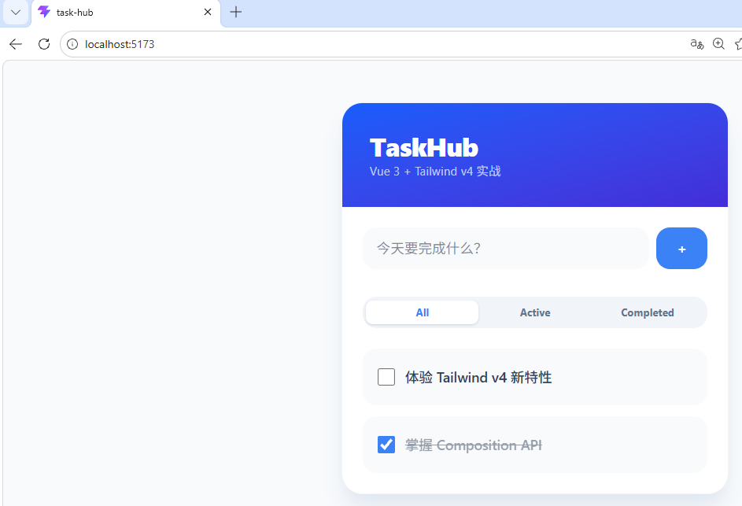

### **核心知识点总结**

defineProps (父传子)：

- TaskItem 通过 props 接收任务数据。在 Vue 中，Props 是只读的。子组件绝不应该直接修改 props 的值，这就是"单向数据流"。

defineEmits (子传父)：

- 当子组件需要改变数据时（如删除、勾选），它通过 emit 发出信号，由父组件执行真正的修改逻辑。这样保证了数据的修改源头只有一个，方便调试。

defineModel (双向绑定神器)：

- 在 TaskFilter 中，我们使用了 Vue 3.4 引入的 defineModel。它极大地简化了父子组件之间状态同步的代码，不再需要手动写 props 和监听 @update:modelValue。

Tailwind v4 的复用性：

- 即使拆分了组件，Tailwind 的原子化类名依然生效。因为 Vite 插件会自动扫描 src 下所有的 .vue 文件并生成对应的样式。

# 状态管理与数据持久化

完成了组件化，现在面临最后一个实战痛点：页面刷新，数据全丢。

为了解决这个问题，将引入 Vue 官方推荐的状态管理库 Pinia，并结合 Tailwind v4 的样式能力，实现数据的持久化存储。

## Pinia 状态管理与数据持久化

Pinia 是 Vue.js 的轻量级状态管理库，能够在组件之间共享和管理状态，可以把 Pinia 想象成一个全局的数据仓库，所有组件都可以从这里获取数据或者更新数据。

### **为什么要用 Pinia？**

在之前的代码中，数据都在 App.vue 里。如果项目变大（比如增加统计页面、用户中心），在组件间传递数据会变成套娃式的噩梦（Props Hell）。

- Pinia 提供了一个全局的数据仓库。
- 任何组件都可以直接从仓库取数据，或者触发仓库的方法。

安装与初始化：

```bash
npm install pinia
npm install @vue/devtools-kit -D
```

在 src/main.js 中注册：

```js
import { createApp } from 'vue'
import { createPinia } from 'pinia'
import App from './App.vue'
import './style.css'
const app = createApp(App)
app.use(createPinia()) // 插件注册
app.mount('#app')
```

### **创建 Task Store (仓库)**

在 src 目录下创建 stores 目录，然后在 src/stores 目录下新建 taskStore.js。

把原本在 App.vue 里的逻辑全部搬过来加入taskStore.js。

```js
import { defineStore } from 'pinia'
import { ref, computed, watch } from 'vue'
export const useTaskStore = defineStore('task-store', () => {
  // --- 1. 状态 (State) ---
  // 尝试从 LocalStorage 读取初始值
  const savedTasks = localStorage.getItem('my-tasks')
  const tasks = ref(savedTasks ? JSON.parse(savedTasks) : [])
  const filter = ref('all')
  // --- 2. 派生状态 (Getters) ---
  const filteredTasks = computed(() => {
    if (filter.value === 'active') return tasks.value.filter(t => !t.isCompleted)
    if (filter.value === 'completed') return tasks.value.filter(t => t.isCompleted)
    return tasks.value
  })
  // --- 3. 动作 (Actions) ---
  const addTask = (title) => {
    tasks.value.unshift({ id: crypto.randomUUID(), title, isCompleted: false })
  }
  const removeTask = (id) => {
    tasks.value = tasks.value.filter(t => t.id !== id)
  }
  const toggleTask = (id) => {
    const task = tasks.value.find(t => t.id === id)
    if (task) task.isCompleted = !task.isCompleted
  }
  // --- 4. 持久化 (Persistence) ---
  // 监听 tasks 的变化，一旦变化就写入 LocalStorage
  watch(tasks, (newVal) => {
    localStorage.setItem('my-tasks', JSON.stringify(newVal))
  }, { deep: true }) // 深度监听数组内部对象的变化
  return {
    tasks,
    filter,
    filteredTasks,
    addTask,
    removeTask,
    toggleTask
  }
})
```

### **重构 App.vue (连接仓库)**

现在的 App.vue 不需要自己管理数据了，只需调用 Store 即可。

```vue
<script setup>
import { storeToRefs } from 'pinia'
import { useTaskStore } from '@/stores/taskStore'
import TaskHeader from './components/TaskHeader.vue'
import TaskInput from './components/TaskInput.vue'
import TaskFilter from './components/TaskFilter.vue'
import TaskItem from './components/TaskItem.vue'
// 初始化仓库
const taskStore = useTaskStore()
// 使用 storeToRefs 保持数据的响应式解构
// 这样在模板里可以直接用 filter 和 filteredTasks
const { filter, filteredTasks } = storeToRefs(taskStore)
const { addTask, removeTask, toggleTask } = taskStore
</script>
<template>
  <div class="min-h-screen py-12 px-4">
    <div class="max-w-md mx-auto bg-white rounded-3xl shadow-xl border border-slate-100 overflow-hidden">
      <TaskHeader />
      <main class="p-6">
        <TaskInput @add-task="addTask" />
        <TaskFilter v-model="filter" />
        <ul class="space-y-3">
          <TransitionGroup name="list">
            <TaskItem
              v-for="task in filteredTasks"
              :key="task.id"
              :task="task"
              @toggle="toggleTask"
              @remove="removeTask"
            />
          </TransitionGroup>
        </ul>
      </main>
    </div>
  </div>
</template>
```

浏览器截图

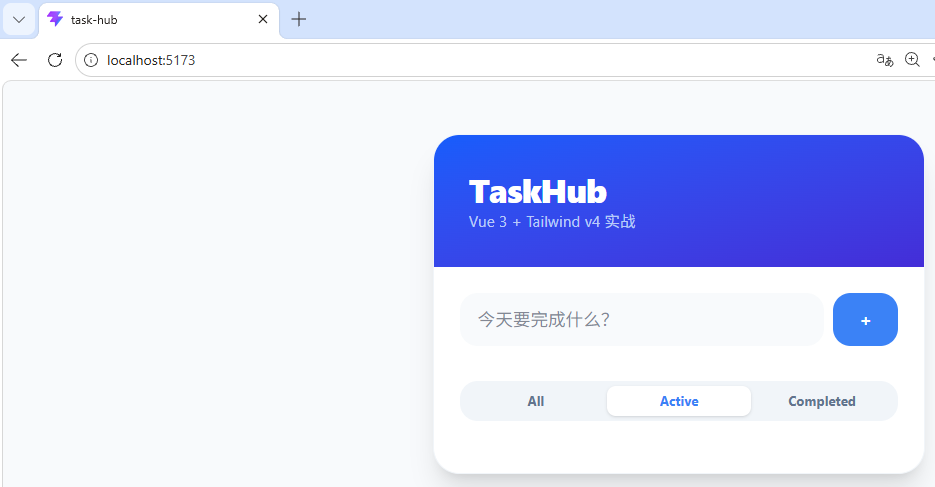

## 知识点详解

### **1.****storeToRefs****是什么？**

如果你直接这样写：const { filter } = taskStore，你会丢失响应式。当你修改 filter 时，页面不会刷新。

- 原因：Store 是一个用 reactive 包裹的对象，直接解构会破坏引用。
- 解决方法：使用 storeToRefs。它会将仓库里的状态转换为 ref，确保解构后依然能"牵一发而动全身"。

### **2.****watch****的深度监听 (deep: true)**

在持久化逻辑中，我们监听的是 tasks 数组。

- 如果不加 { deep: true }，只有当数组被替换（如 tasks.value = []）时才会触发保存。
- 加上后，数组内部对象的属性修改（如任务从"待办"变"完成"）也会被捕获并存入硬盘。

### **3. 持久化思路**

我们采用了"初始化读取 + 变更写入"的闭环：

1. 读取：Store 创建时从 localStorage 获取数据，让应用有"记忆"。
2. 写入：利用 watch 实现全自动化同步，开发者再也不用手动写 setItem。

## 7.tailwind v4 的最终润色

在 Store 的加持下，可以给应用增加一些全局反馈样式。比如在 TaskHeader.vue 中展示任务进度：

```vue
<script setup>
import { computed } from 'vue';
import { storeToRefs } from 'pinia';
import { useTaskStore } from '@/stores/taskStore'; // 确保路径正确
// 1. 初始化 store
const taskStore = useTaskStore();
// 2. 使用 storeToRefs 解构 tasks，确保它是响应式的
// 如果直接 const { tasks } = taskStore; 进度条将不会随勾选而移动
const { tasks } = storeToRefs(taskStore);
// 3. 编写进度逻辑
const progress = computed(() => {
  const total = tasks.value.length;
  if (total === 0) return 0; // 防止除以零
  const completedCount = tasks.value.filter(t => t.isCompleted).length;
  // 计算百分比并取整
  return Math.round((completedCount / total) * 100);
});
</script>
<template>
  <header class="bg-linear-to-br from-blue-600 to-indigo-700 p-8 text-white">
    <h1 class="text-3xl font-black tracking-tight">TaskHub</h1>
    <div class="mt-6">
      <div class="flex justify-between items-end mb-2">
        <p class="text-blue-100/80 text-xs font-bold uppercase tracking-wider">完成进度</p>
        <span class="text-2xl font-mono font-black">{{ progress }}%</span>
      </div>
      <div class="h-2 w-full bg-white/20 rounded-full overflow-hidden backdrop-blur-sm">
        <div
          class="h-full bg-white shadow-[0_0_15px_rgba(255,255,255,0.5)] transition-all duration-500 ease-out"
          :style="{ width: `${progress}%` }"
        ></div>
      </div>
    </div>
  </header>
</template>
```

修改后，整个界面就有了进度条的功能：

浏览器截图

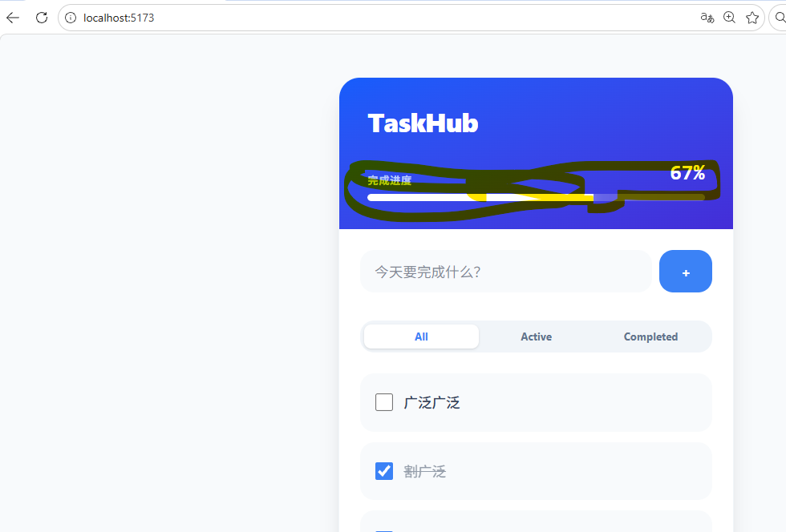

# 8.路由系统

任务管理逻辑已经通过 Pinia 实现了持久化，现在需要为应用注入灵魂——路由系统。

在企业级开发中，路由不只是切换页面，更承担了安全性（权限控制）和用户体验（动态标题）的重任。

## 安装与基础配置

首先安装 Vue Router：

```bash
npm install vue-router
```

在 src 目录下创建 router 目录，并创建 router/index.js 文件。

在index.js文件中定义两个页面：工作台 (Dashboard) 和 登录页 (Login)。

```js
import { createRouter, createWebHistory } from 'vue-router'
const routes = [
  {
    path: '/login',
    name: 'Login',
    component: () => import('@/views/Login.vue'),
    meta: { title: '登录 - TaskHub', requiresAuth: false }
  },
  {
    path: '/',
    name: 'Dashboard',
    component: () => import('@/views/Dashboard.vue'),
    // 路由元信息 meta：用来存放自定义数据
    meta: {
      title: '我的工作台',
      requiresAuth: true,
      breadcrumb: '首页'
    }
  }
]
const router = createRouter({
  history: createWebHistory(),
  routes
})
export default router
```

在 src 下创建 views 文件夹，并分配好页面。

- src/App.vue：根容器，只放 <router-view /> 和全局动画。
- src/views/Dashboard.vue：原本的 TaskHub 核心功能（任务列表、输入框等）。
- src/views/Login.vue：新增的登录页面。

### **改造****App.vue****(变成干净的容器)**

```js
//App.vue
<template>
  <div class="min-h-screen bg-slate-50">
    <router-view v-slot="{ Component }">
      <transition name="page" mode="out-in">
        <component :is="Component" />
      </transition>
    </router-view>
  </div>
</template>
<style>
/* 页面切换的淡入淡出效果 */
.page-enter-active, .page-leave-active {
  transition: opacity 0.2s ease;
}
.page-enter-from, .page-leave-to {
  opacity: 0;
}
</style>
```

### **把原本的逻辑迁入****Dashboard.vue**

把之前在 App.vue 里写的那些代码（引入 Store、引入组件、模板布局）全部剪切到 src/views/Dashboard.vue 中。

```vue
<script setup>
import { storeToRefs } from 'pinia'
import { useTaskStore } from '@/stores/taskStore'
import { useRouter } from 'vue-router' // 引入路由
import TaskHeader from '@/components/TaskHeader.vue'
import TaskInput from '@/components/TaskInput.vue'
import TaskFilter from '@/components/TaskFilter.vue'
import TaskItem from '@/components/TaskItem.vue'
const taskStore = useTaskStore()
const router = useRouter()
const { filter, filteredTasks } = storeToRefs(taskStore)
const { addTask, removeTask, toggleTask } = taskStore
// 退出登录方法
const handleLogout = () => {
  localStorage.removeItem('isLoggedIn')
  router.push('/login')
}
</script>
<template>
  <div class="py-12 px-4">
    <div class="max-w-md mx-auto bg-white rounded-3xl shadow-xl border border-slate-100 overflow-hidden">
      <TaskHeader />
      <main class="p-6">
        <TaskInput @add-task="addTask" />
        <TaskFilter v-model="filter" />
        <ul class="space-y-3">
          <TransitionGroup name="list">
            <TaskItem
              v-for="task in filteredTasks"
              :key="task.id"
              :task="task"
              @toggle="toggleTask"
              @remove="removeTask"
            />
          </TransitionGroup>
        </ul>
        <button
          @click="handleLogout"
          class="mt-8 w-full py-2 text-xs text-slate-400 hover:text-red-500 transition-colors"
        >
          退出当前账号
        </button>
      </main>
    </div>
  </div>
</template>
```

### **登录逻辑实现 (Login.vue)**

利用 Tailwind v4 快速构建一个极简登录页，并模拟登录行为。

```vue
<script setup>
import { ref } from 'vue'
import { useRouter } from 'vue-router'
const router = useRouter()
const isLoading = ref(false)
const handleLogin = () => {
  isLoading.value = true
  // 模拟异步请求
  setTimeout(() => {
    localStorage.setItem('isLoggedIn', 'true')
    router.push('/') // 登录成功跳转首页
    isLoading.value = false
  }, 1000)
}
</script>
<template>
  <div class="min-h-screen flex items-center justify-center bg-slate-50">
    <div class="p-8 bg-white rounded-3xl shadow-xl w-full max-w-sm border border-slate-100">
      <h2 class="text-2xl font-black mb-6 text-slate-800">欢迎回来</h2>
      <button
       @click="handleLogin"
       :disabled="isLoading"
       class="w-full bg-linear-to-r from-blue-600 to-indigo-600 text-white py-3 rounded-xl font-bold hover:opacity-90 active:scale-95 transition-all disabled:opacity-50"
     >
        {{ isLoading ? '登录中...' : '一键进入系统' }}
      </button>
      <p class="mt-4 text-center text-xs text-slate-400">测试环境：点击即可登录</p>
    </div>
  </div>
</template>
```

### **完善****router/index.js****的拦截逻辑**

确保路由配置中已经开启了安检模式：

```js
import { createRouter, createWebHistory } from 'vue-router'
const routes = [
  {
    path: '/login',
    name: 'Login',
    component: () => import('@/views/Login.vue'),
    meta: { title: '登录 - TaskHub', requiresAuth: false }
  },
  {
    path: '/',
    name: 'Dashboard',
    component: () => import('@/views/Dashboard.vue'),
    // 路由元信息 meta：用来存放自定义数据
    meta: {
      title: '我的工作台',
      requiresAuth: true,
      breadcrumb: '首页'
    }
  }
]
const router = createRouter({
  history: createWebHistory(),
  routes
})
// src/router/index.js (核心片段)
router.beforeEach((to, from, next) => {
  const isAuthenticated = localStorage.getItem('isLoggedIn') === 'true'
  // 如果去首页但没登录 -> 去登录
  if (to.meta.requiresAuth && !isAuthenticated) {
    next('/login')
  }
  // 如果已登录还想去登录页 -> 回首页
  else if (to.path === '/login' && isAuthenticated) {
    next('/')
  }
  else {
    next()
  }
})
export default router
```

### **在****main.js****中完成最后拼图**

确保 main.js 引入并挂载了路由：

```js
import { createApp } from 'vue'
import { createPinia } from 'pinia'
import router from './router' // 引入路由
import App from './App.vue'
import './style.css'
const app = createApp(App)
app.use(createPinia())
app.use(router) // 2. 注册路由
app.mount('#app')
```

### **最终效果**

1. 访问 /：如果你没登录，页面会闪现一下然后跳转到/login。
2. 访问 /login：点击按钮，本地存储isLoggedIn变为true，然后瞬间切入工作台。
3. 刷新页面：Pinia 会从 LocalStorage 读取任务，路由守卫会检查登录状态，一切数据都不会丢失。

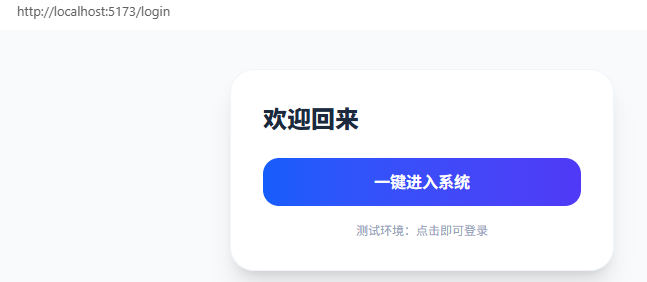

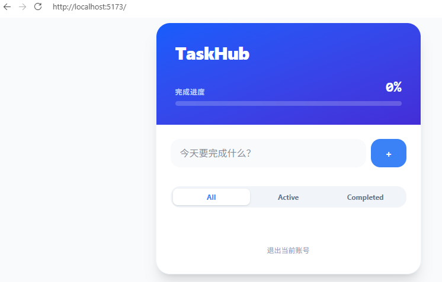

### **知识点介绍**

1. 为什么 App.vue 变空了？  
在单页面应用（SPA）中，App.vue 是整个应用的外壳。把它变空是为了能根据 URL 的变化，在其中动态地塞进不同的页面（Dashboard 或 Login）。
2. useRouter 的实战：  
在 Dashboard.vue 中，通过 router.push('/login') 实现了退出功能。注意：push 会向浏览器历史记录添加一条新记录，点击浏览器返回键是可以回退的。
3. Tailwind v4 的布局继承：  
由于在 App.vue 的全局容器里加了 bg-slate-50 和 min-h-screen，所有的子页面（Dashboard、Login）都会默认继承这个浅灰色背景，保证了视觉的统一性。

# 9.逻辑复用与性能优化

在完成路由与登录逻辑后，随着项目规模扩大，发现有些逻辑（如存取本地数据、弹出通知）在多个页面反复出现。同时，如果任务列表达到上千条，页面可能会出现卡顿。

这一阶段，可以将通过 Composition API 的深度应用 来解决代码复用和性能瓶颈问题。

## 逻辑复用：自定义 Composables (Hooks)

Composables 是 Vue 3 的精髓，它允许将逻辑（State + Actions）抽离成独立函数。

### **useLocalStorage：数据持久化逻辑抽离**

不再在每个 Store 或组件里手写 localStorage.getItem。

新建目录 `src/composables，新建文件src/composables/useLocalStorage.js`

```js
// src/composables/useLocalStorage.js
import { ref, watch } from 'vue';
export function useLocalStorage(key, defaultValue = null) {
  // 1. 初始化数据
  const storedValue = localStorage.getItem(key);
  const data = ref(storedValue ? JSON.parse(storedValue) : defaultValue);
  // 2. 监听变化并自动同步
  watch(data, (newValue) => {
    localStorage.setItem(key, JSON.stringify(newValue));
  }, { deep: true });
  return data;
}
```

在taskStore.js中的 localStorage.getItem替换为useLocalStorage。

### **useNotification：公共 UI 逻辑抽离**

**新建**src/composables/useNotification.js

实现一个简单的通知提示功能。

```js
// src/composables/useNotification.js
import { ref } from 'vue';
export function useNotification() {
  const message = ref('');
  const isVisible = ref(false);
  const notify = (msg, duration = 2000) => {
    message.value = msg;
    isVisible.value = true;
    setTimeout(() => {
      isVisible.value = false;
    }, duration);
  };
  return { message, isVisible, notify };
}
```

## 性能调优：处理大数据量与高频渲染

当你的 TaskHub 从管理 10 个任务增长到管理 1000 个任务时，Vue 默认的"深度响应式"会带来计算压力。

### **shallowRef****与****markRaw**

Vue 默认的 ref 是递归响应式的（即对象内部的每个属性都会被代理）。

shallowRef：只监听 .value 的指向变化，不监听对象内部属性的变化。

- 场景：当你从后端获取一大串只读的任务历史记录时。

markRaw：标记一个对象，使其永远不会被转为响应式。

- 场景：某些复杂的第三方库实例（如 ECharts 图表实例、地图实例），包装成响应式反而会报错或极度耗费性能。

```js
// 性能优化示例
import { shallowRef, markRaw } from 'vue';
// 假设这是一万条历史归档数据
const archiveTasks = shallowRef([]);
const loadArchive = (data) => {
  // 仅在赋值时触发一次响应式更新，内部属性修改不触发
  archiveTasks.value = data;
};
```

### **v-once****与****v-memo****(指令级优化)**

#### v-once：静态内容只渲染一次

如果某个任务渲染后就不再变化（比如任务的创建时间），使用 v-once。

```
<span v-once>创建于: {{ task.createdAt }}</span>
```

- 原理：Vue 渲染后会跳过该节点的后续更新检查。

#### v-memo：按需更新（Vue 3.2+）

这是优化长列表最强大的指令。它接受一个依赖数组，只有当数组里的值变化时，该节点及其子节点才会重新渲染。

```vue
<li v-for="task in tasks" :key="task.id" v-memo="[task.isCompleted, task.title]">
  {{ task.title }} - {{ task.isCompleted }}
</li>
```

## 结合到之前的项目中

可以尝试在 TaskItem.vue 中应用 v-memo：

```vue
<template>
  <li v-memo="[task.id, task.isCompleted]" class="...">
     ...
  </li>
</template>
```

现在项目不仅逻辑清晰（Composables），而且性能强劲。、

# **10.**项目部署

将它从本地开发环境推向生产服务器。

在企业级落地中，需要确保代码在不同环境（测试、生产）能自动切换配置，并且加载速度极快。

## 环境变量管理：一套代码，多处运行

在真实开发中，API 地址或一些配置在开发环境和线上环境是不一样的。

Vite 默认支持 .env 文件。

在项目根目录下创建两个文件：

```
.env.development     (本地开发)
VITE_API_BASE_URL=http://localhost:3000/api
VITE_APP_TITLE=TaskHub (Dev)
.env.production      (线上生产)
VITE_API_BASE_URL=https://api.taskhub.com
VITE_APP_TITLE=TaskHub
```

说明：

- Vite 要求变量必须以 VITE_ 开头才能被暴露给客户端代码。
- 在代码中通过 import.meta.env.VITE_API_BASE_URL 访问。

## 打包优化：极致的加载速度

当项目引入了 Vue Router, Pinia 等库后，打包出的 index.js 会变得很大。需要通过"分包"和"压缩"来优化。

### **分包策略 (Manual Chunks)**

修改 vite.config.js，将第三方库打包成独立的 JS 文件，利用浏览器缓存。

```js
// vite.config.js
export default defineConfig({
  build: {
    rollupOptions: {
      output: {
        manualChunks: {
          // 将 vue 相关库打包在一起
          'vue-vendor': ['vue', 'vue-router', 'pinia'],
          // 其他第三方库（如以后引入的 axios 或 echarts）
          // 'utils-vendor': ['axios'],
        }
      }
    }
  }
})
```

### **Gzip 压缩配置**

安装插件：npm install -D vite-plugin-compression

```js
import viteCompression from 'vite-plugin-compression'
export default defineConfig({
  plugins: [
    // ...
    viteCompression({
      threshold: 10240, // 超过 10kb 的文件才压缩
      algorithm: 'gzip',
      ext: '.gz'
    })
  ]
})
```

## 自动化部署 (CI/CD)

以最流行的 GitHub Actions 为例，当你把代码推送到 GitHub 时，它会自动帮你打包并部署到 GitHub Pages 或你的服务器。

### **创建 Workflow 脚本**

在项目根目录创建 .github/workflows/deploy.yml：

```yaml
name: Deploy TaskHub
on:
  push:
    branches: [ main ] # 监听 main 分支的推送
jobs:
  build-and-deploy:
    runs-on: ubuntu-latest
    steps:
      - name: Checkout 🛎️
        uses: actions/checkout@v4
      - name: Install and Build 🔧
        run: |
          npm install
          npm run build
      - name: Deploy 🚀
        uses: JamesIves/github-pages-deploy-action@v4
        with:
          folder: dist # 打包产物目录
          branch: gh-pages # 部署到这个分支
```

## 11.TaskHub 项目全路线总结

到这里，已经完成了一个从零开始、基于 Vue 3 (JavaScript) + Tailwind v4 的企业级实战项目：

1. 架构层：Vite + Tailwind v4 + Vue Router + Pinia。
2. 逻辑层：Composition API + 自定义 Composables 复用。
3. 性能层：shallowRef + v-memo + 打包分包。
4. 工程层：环境变量 + CI/CD 自动化部署。
